# Billing figure gallery

All 16 figures below are unchanged saved images from the final V4 and V5 notebooks. The data is synthetic. They have not been recomputed or clinically validated. See [results](RESULTS.md) and [methods and limitations](METHODS_AND_LIMITATIONS.md) for version and evaluation qualifications.

[Complete billing notebooks and safe outputs](FULL_BILLING_REPORT.md) · [Operations figure gallery](OPERATIONS_GALLERY.md)

## Figure 1 1. Baseline vs Final Selected Model

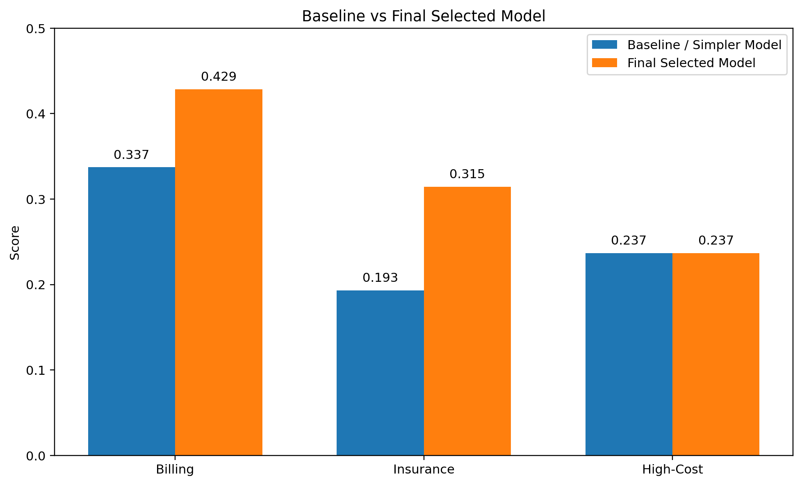

Original V4 saved output, zero-based source cell 5, output 3. Original wording is retained; feature-importance and clinical-style titles do not establish causal or clinical validity.

## Figure 2 2. Billing Category Distribution

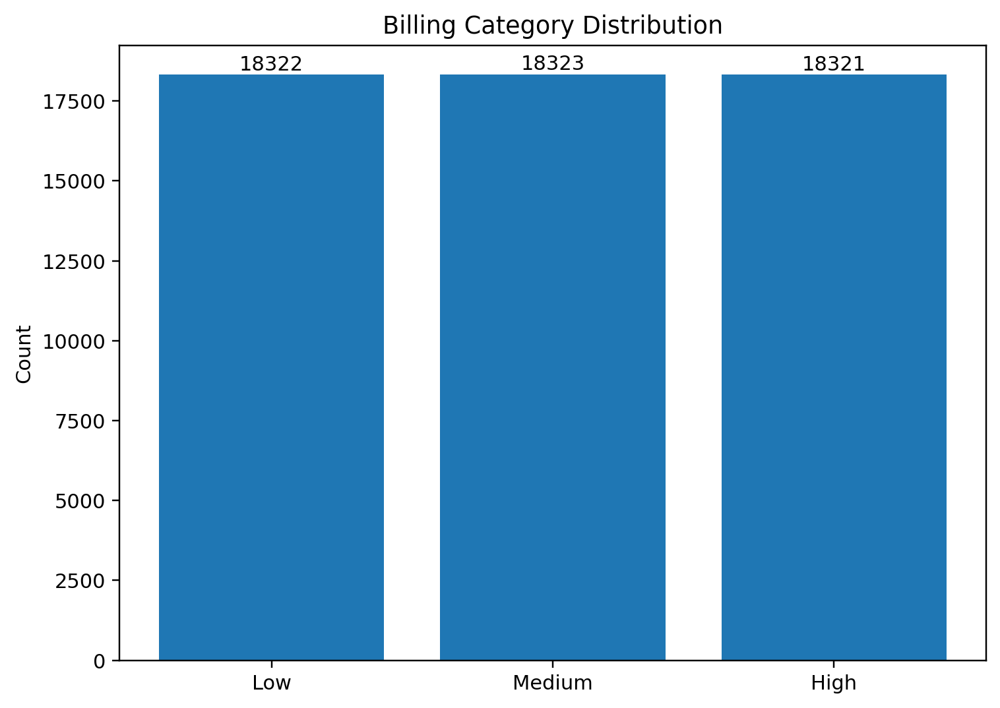

Original V4 saved output, zero-based source cell 5, output 7. Original wording is retained; feature-importance and clinical-style titles do not establish causal or clinical validity.

## Figure 3 3. Billing Category Model Comparison

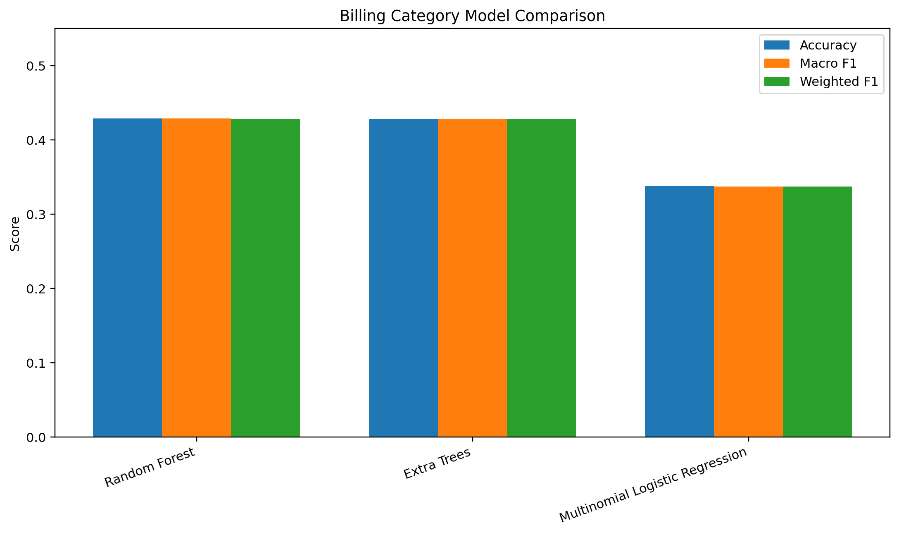

Original V4 saved output, zero-based source cell 5, output 11. Original wording is retained; feature-importance and clinical-style titles do not establish causal or clinical validity.

## Figure 4 4. Billing Category Confusion Matrix

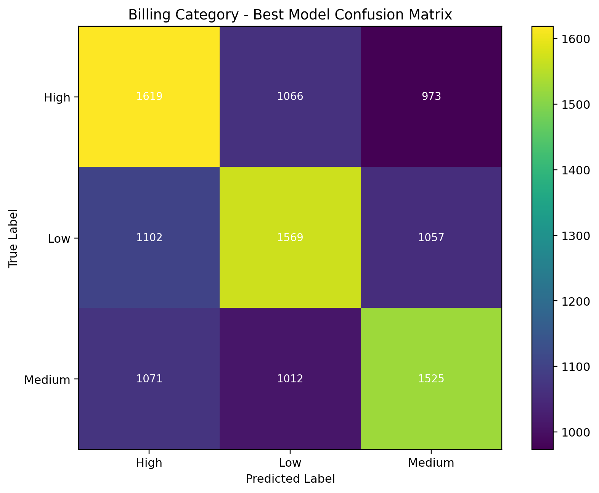

Original V4 saved output, zero-based source cell 5, output 15. Original wording is retained; feature-importance and clinical-style titles do not establish causal or clinical validity.

## Figure 5 5. Insurance Provider Distribution

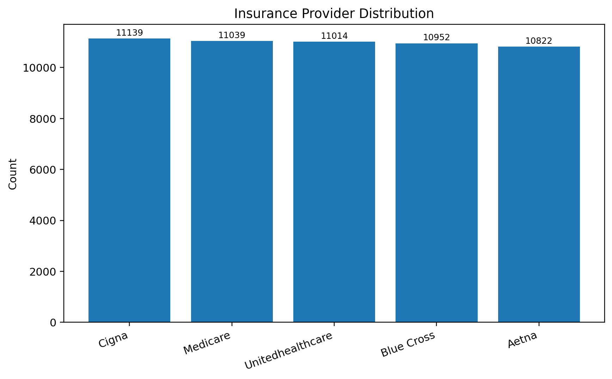

Original V4 saved output, zero-based source cell 5, output 19. Original wording is retained; feature-importance and clinical-style titles do not establish causal or clinical validity.

## Figure 6 6. Insurance Provider Model Comparison

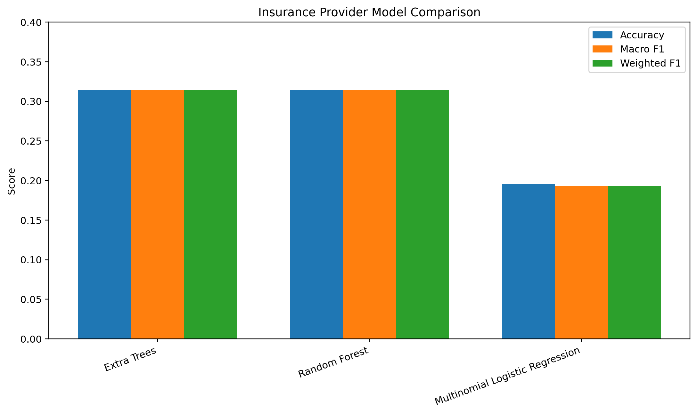

Original V4 saved output, zero-based source cell 5, output 23. Original wording is retained; feature-importance and clinical-style titles do not establish causal or clinical validity.

## Figure 7 7. Insurance Provider Confusion Matrix

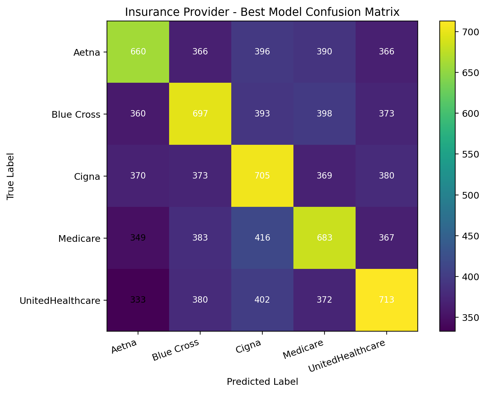

Original V4 saved output, zero-based source cell 5, output 27. Original wording is retained; feature-importance and clinical-style titles do not establish causal or clinical validity.

## Figure 8 8. High-Cost Patient Distribution

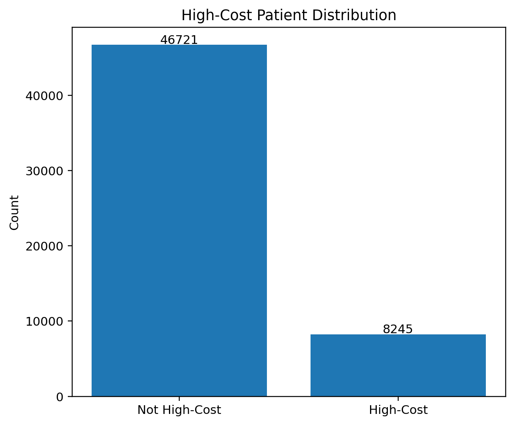

Original V4 saved output, zero-based source cell 5, output 31. Original wording is retained; feature-importance and clinical-style titles do not establish causal or clinical validity.

## Figure 9 9. High-Cost Patient Model Comparison

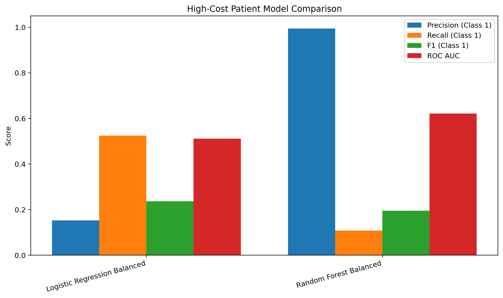

Original V4 saved output, zero-based source cell 5, output 35. Original wording is retained; feature-importance and clinical-style titles do not establish causal or clinical validity.

## Figure 10 10. High-Cost ROC AUC Comparison

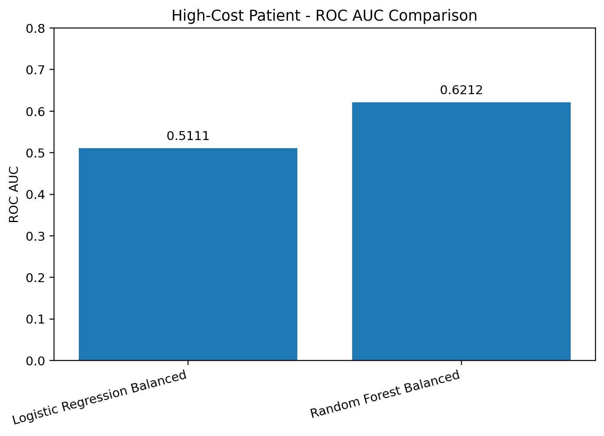

Original V4 saved output, zero-based source cell 5, output 39. Original wording is retained; feature-importance and clinical-style titles do not establish causal or clinical validity.

## Figure 11 11. Hospital System Distribution

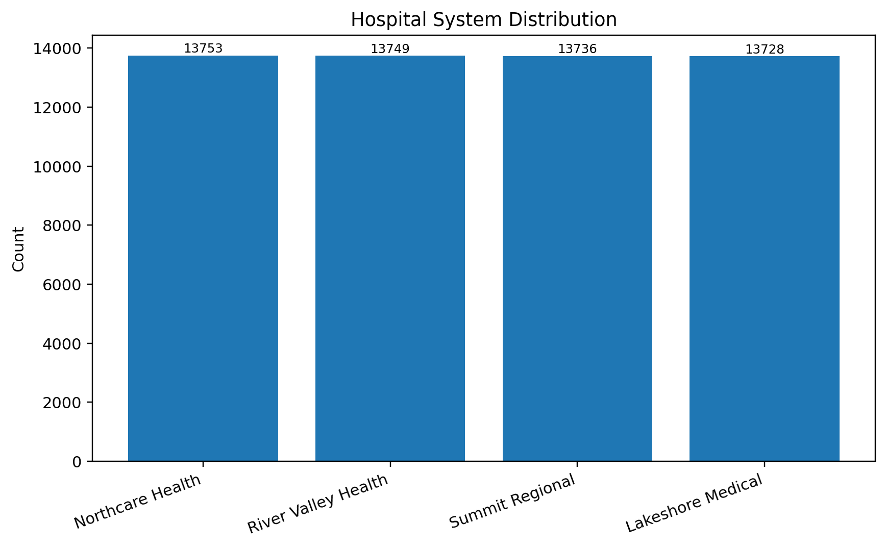

Original V4 saved output, zero-based source cell 5, output 43. Original wording is retained; feature-importance and clinical-style titles do not establish causal or clinical validity.

## Figure 12 12. Final Selected Results Overview

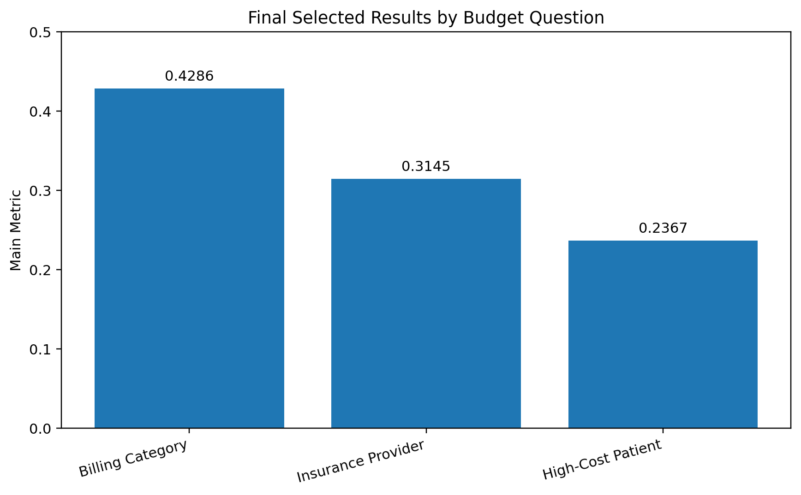

Original V4 saved output, zero-based source cell 5, output 47. Original wording is retained; feature-importance and clinical-style titles do not establish causal or clinical validity.

## Figure 13 Billing-category confusion matrix

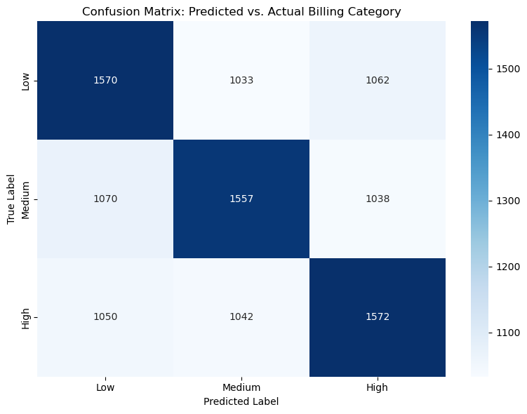

Original V5 saved output, zero-based source cell 5, output 0. Original wording is retained; feature-importance and clinical-style titles do not establish causal or clinical validity.

## Figure 14 Length of stay by synthetic billing category

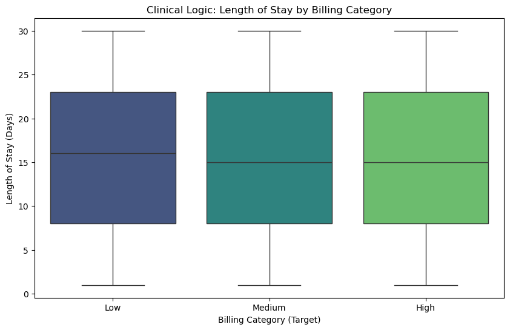

Original V5 saved output, zero-based source cell 6, output 0. Original wording is retained; feature-importance and clinical-style titles do not establish causal or clinical validity.

## Figure 15 Original billing feature importance

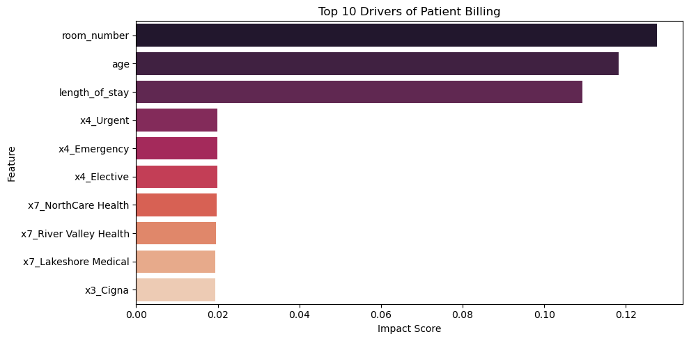

Original V5 saved output, zero-based source cell 7, output 0. Original wording is retained; feature-importance and clinical-style titles do not establish causal or clinical validity.

## Figure 16 Billing-category distribution

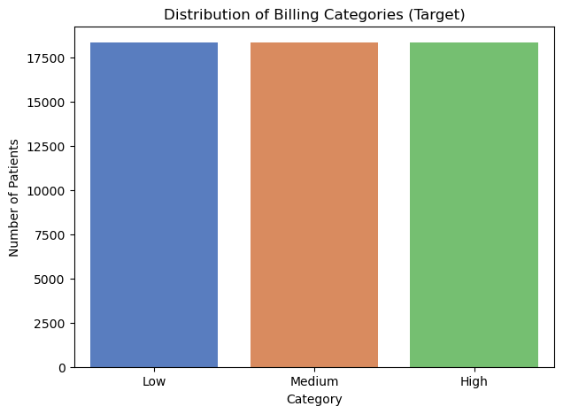

Original V5 saved output, zero-based source cell 8, output 0. Original wording is retained; feature-importance and clinical-style titles do not establish causal or clinical validity.
