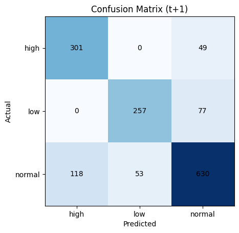
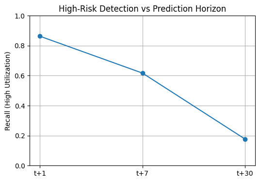
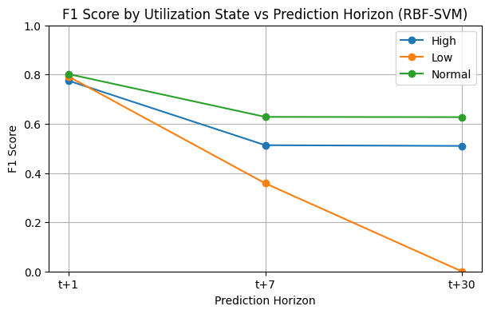
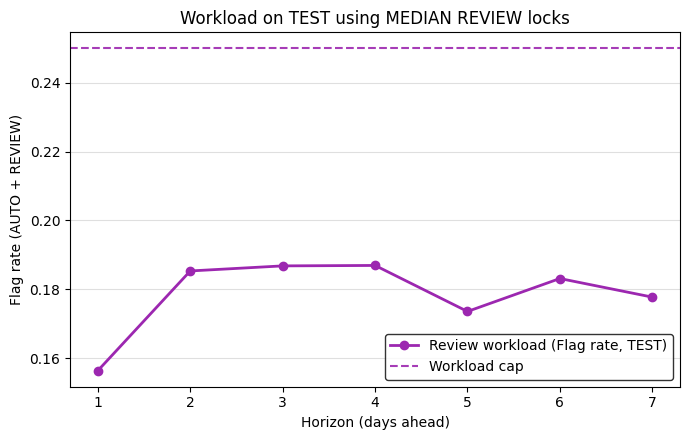
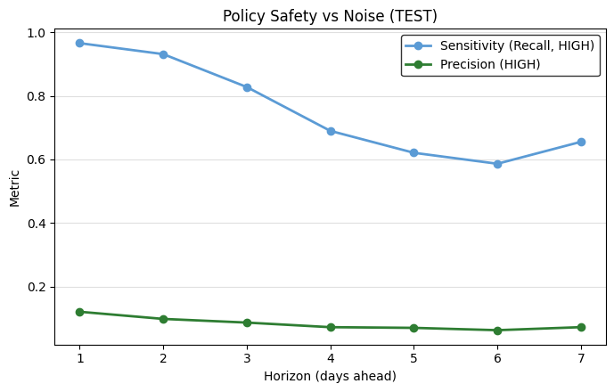
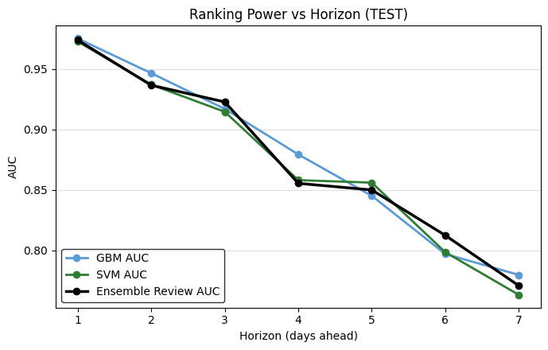
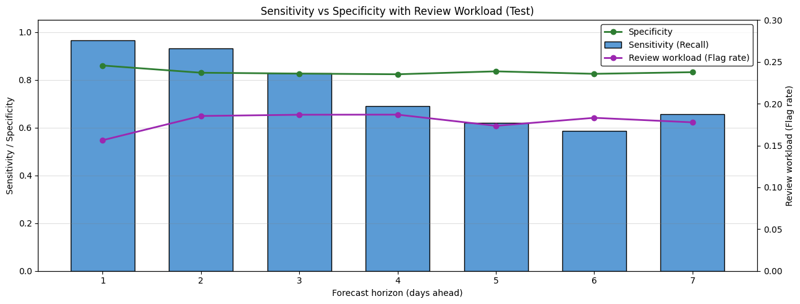
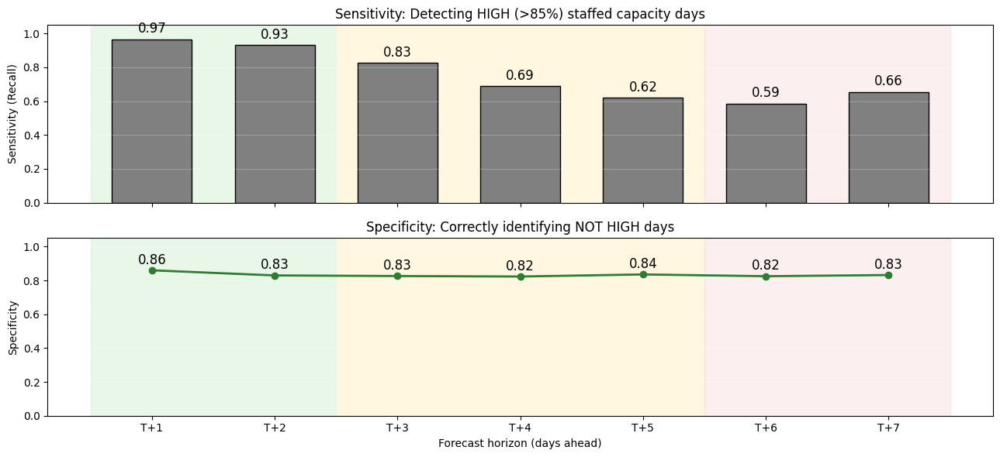
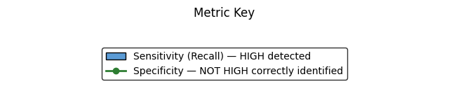

# Healthcare Operations Visual Gallery

Original saved aggregate figures from the collaborative healthcare ML coursework. The inputs are synthetic records; hospital groupings and capacity definitions are artificial modeling constructs. These figures were preserved without rerunning the models.

[Source and saved results audit](technical/operations_source_audit.json) · [Figure fingerprints](technical/operations_figure_manifest.json) · [Methods and limitations](METHODS_AND_LIMITATIONS.md) · [Results](RESULTS.md)

The original baseline and refined source are available as [baseline.py](src/operations/baseline.py) and [refined.py](src/operations/refined.py). Their private input paths are replaced for publication. No real-world operational reliability, staffing deployment or clinical validation is established.

## Figure 1: Baseline next-day confusion matrix

A saved three-class room-utilization diagnostic. The baseline code uses a random stratified split, despite its time-safe comment. This is a historical synthetic-data result, not a prospective hospital validation.

Saved source: baseline asset `output_17_0.png`. Byte-identical PNG; see the manifest for its SHA-256 fingerprint.

## Figure 2: Baseline high-state recall across horizons

The baseline script plots manually entered recall values for t+1, t+7 and t+30. The values are historical observations recorded by the team, not results recomputed for this publication. They must not be read as validated forecast reliability.

Saved source: baseline asset `output_24_0.png`. Byte-identical PNG; see the manifest for its SHA-256 fingerprint.

## Figure 3: Baseline SVM class F1 across horizons

The script plots manually entered F1 arrays for the three synthetic utilization states. The recorded t+30 low-state F1 is zero; performance differs markedly by class and horizon.

Saved source: baseline asset `output_25_0.png`. Byte-identical PNG; see the manifest for its SHA-256 fingerprint.

## Figure 4: Refined review workload across horizons

The locked-policy saved results flag roughly 15.6% to 18.7% of held-out coalition-days for review. The dashed 25% cap is a prototype workload setting, not an approved staffing policy. AUTO is disabled at every horizon in this final result set.

Saved source: refined asset `output_12_0.png`. Byte-identical PNG; see the manifest for its SHA-256 fingerprint.

## Figure 5: Refined recall and precision across horizons

High recall coexists with low precision: the saved t+1 review policy catches 28 of 29 positive test days but also flags 204 negative days. Its precision is about 12.1%; longer-horizon precision is lower. This tradeoff should accompany any recall or AUC claim.

Saved source: refined asset `output_13_0.png`. Byte-identical PNG; see the manifest for its SHA-256 fingerprint.

## Figure 6: Refined score-ranking AUC across horizons

These are saved score-ranking diagnostics for gradient boosting, RBF SVM and the maximum-score review rule. They are not a new run, probability-calibration evidence or proof of clinical utility; the capacity target and feature construction have the limitations in Methods and limitations.

Saved source: refined asset `output_14_0.png`. Byte-identical PNG; see the manifest for its SHA-256 fingerprint.

## Figure 7: Refined sensitivity, specificity and workload

This saved summary makes the detection-versus-alert-workload tradeoff visible. All states concern an artificial capacity proxy constructed from synthetic records; no real staffing roster or bed-capacity measurement is used.

Saved source: refined asset `output_15_0.png`. Byte-identical PNG; see the manifest for its SHA-256 fingerprint.

## Figure 8: Refined sensitivity and specificity by horizon

The chart uses the team's original colored horizon regions. These colors are presentation annotations, not independently validated operating windows. The held-out set contains only 29 positive coalition-days per horizon.

Saved source: refined asset `output_16_0.png`. Byte-identical PNG; see the manifest for its SHA-256 fingerprint.

## Figure 9: Original horizon-region key

The original legend calls short horizons Actionable. That wording is retained as historical presentation content only; it does not establish real-world actionability, clinical readiness or safe deployment.

Saved source: refined asset `output_17_1.png`. Byte-identical PNG; see the manifest for its SHA-256 fingerprint.

## Figure 10: Original metric key

The saved key defines sensitivity as detection of HIGH proxy days and specificity as correct identification of NOT HIGH proxy days. These are synthetic operational labels, not patient outcome measures.

Saved source: refined asset `output_18_1.png`. Byte-identical PNG; see the manifest for its SHA-256 fingerprint.
