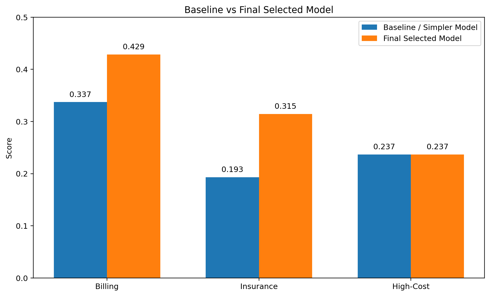

# Healthcare Machine Learning and Operations

A collaborative academic project using **synthetic healthcare data** to compare
billing models and explore occupancy alerts. The team worked through data
cleaning, feature engineering, classification and regression baselines,
cross-validation, hyperparameter search and operational decision thresholds.

**Python · Pandas · NumPy · scikit-learn · XGBoost · Feature engineering · Model evaluation**

**Team:** Hinsoukpo Dagan, Drew Fleming, Kathleen Hinderscheid, Benjamin Philbin,
Dymend Teklab and Vansh Verma. Original coursework: 2026. Vansh contributed to
cleaning, feature engineering, preprocessing, model comparison, evaluation,
documentation and presentation within the team project.

[Complete billing notebooks and outputs](FULL_BILLING_REPORT.md) ·
[Billing figures](FIGURE_GALLERY.md) · [Operations figures](OPERATIONS_GALLERY.md) ·
[Results and evaluation context](RESULTS.md) · [Methods and limitations](METHODS_AND_LIMITATIONS.md)

*Original saved billing comparison. These are historical classroom results on
synthetic data; metrics from different targets, versions and evaluation
populations are kept separate in the [results](RESULTS.md).*

**Included evidence:** two complete final billing notebooks (18 cells), nine
original team Python source files, and 26 original saved aggregate figures
across billing and operations. Publication changes are recorded in the source
manifest; original model code was not executed for this portfolio export.

## New evaluation extension

The [post-submission billing benchmark](REPLAY_EXTENSION.md) adds a runnable,
tested workflow with train-only preprocessing, group-disjoint splits and a
class-prior baseline. A bounded run on 10,000 retained synthetic records found
**weak signal** (test ROC-AUC 0.485). It documents the limits rather than claiming
clinical utility. Original team artifacts below are preserved.

## Project scope

| Workstream | What the team investigated | Source evidence |
| --- | --- | --- |
| Billing and administrative targets | Billing-category classification, insurance-provider classification, high-cost flags and earlier billing-regression baselines | [V4 final notebook](notebooks/billing_v4_final.ipynb), [billing source](src/billing/) and [complete readable report](FULL_BILLING_REPORT.md) |
| V5 billing extension | Interaction features, stratified splitting, five-fold cross-validation, Random Forest search and XGBoost comparison | [V5 extension notebook](notebooks/billing_v5_extension.ipynb) and its four original charts in the [gallery](FIGURE_GALLERY.md) |
| Occupancy and operations | Reconstruct daily occupancy from synthetic admission/discharge dates, define an artificial capacity proxy and compare forward-horizon alert policies | [Baseline source](src/operations/baseline.py), [refined source](src/operations/refined.py) and [operations gallery](OPERATIONS_GALLERY.md) |

The source dataset has **55,500 synthetic rows**. The V4 billing workflow retains
**54,966 rows after removing 534 duplicates**. The operations branch constructs
four artificial coalitions and 7,418 coalition-day observations; these are not
measured hospital staffing records.

## Skills demonstrated

| Skill area | Concrete evidence |
| --- | --- |
| **Python, Pandas and NumPy data preparation** | Duplicate handling, date parsing, derived length-of-stay fields, numeric conversion and grouped transformations in the [billing notebooks](FULL_BILLING_REPORT.md) |
| **Feature engineering and categorical encoding** | One-hot encoding, training-only frequency encoding and interaction features; preprocessing is organized with scikit-learn `Pipeline` and `ColumnTransformer` |
| **Supervised machine learning** | Logistic Regression, Random Forest, Extra Trees, gradient boosting and XGBoost comparisons in [notebooks and billing scripts](src/billing/) |
| **Cross-validation and hyperparameter tuning** | Stratified five-fold evaluation and randomized Random Forest search in the [V5 extension](notebooks/billing_v5_extension.ipynb) |
| **Imbalanced classification and model evaluation** | Macro F1, class-specific F1, precision, recall, confusion matrices, ROC-AUC and threshold trade-offs in [results](RESULTS.md) and [original plots](FIGURE_GALLERY.md) |
| **Time-indexed operational analysis** | Chronological train/validation/test partitions, lag features, forward horizons and review-policy comparison in [operations source](src/operations/) |
| **Data visualization and analytical communication** | Matplotlib/Seaborn figures, model comparisons and explicit discussion of weak signals and evaluation limitations |

## What the results show

The V4 billing Random Forest has saved macro F1 **0.428641**; the insurance
Extra Trees model has **0.314519**. In V5's training-partition five-fold CV,
Random Forest averages **0.4104**, its randomized-search variant **0.4118**, and
XGBoost **0.3544**. These are different tasks or evaluation settings, rather than
one combined leaderboard.

The useful outcome is a documented comparison of preprocessing choices and
models, including where synthetic data provides limited predictive signal.
Raw-billing regression did not establish useful explanatory power. The final
presentation also contains conflicting high-cost figures, which are retained
and explained in [Results](RESULTS.md).

The occupancy branch's saved alert-policy results require caution: the capacity
proxy uses full-series information, some rolling calculations can cross group
boundaries, and the refined source contains an unresolved variable reference.
Review [Methods and limitations](METHODS_AND_LIMITATIONS.md) before interpreting
its high sensitivity. No prospective forecasting or clinical effectiveness is
established by this coursework.

## Read and inspect locally

The original saved results can be inspected without training any model:

1. Open the [complete billing report](FULL_BILLING_REPORT.md) or either notebook.
2. Browse the [billing](FIGURE_GALLERY.md) and [operations](OPERATIONS_GALLERY.md) figures.
3. Inspect the [source inventory and sanitization record](technical/source_manifest.json).
4. Read the [data source and usage notes](DATA_AND_USAGE.md) before obtaining inputs.

`requirements.txt` lists libraries used by the retained source. It is a dependency
inventory rather than a verified environment lock. The public notebooks preserve
their original code and safe saved outputs, with documented privacy and path
changes. The original notebook models were not retrained for the November 8
publication. A separate November 10 benchmark now has a tested environment and
aggregate results; see [the extension](REPLAY_EXTENSION.md). Known original replay
limitations remain listed in the methods notes.

## Data, attribution and boundaries

The [Healthcare Dataset by Prasad Patil](https://www.kaggle.com/datasets/prasad22/healthcare-dataset)
is generated with Faker and is listed as **CC0: Public Domain**. Current provider
metadata was checked November 8, 2026. The public repository contains no raw
record-level dataset or name-like record previews.

This is collaborative educational analysis of synthetic data, with no clinical
deployment, patient-outcome validation or HIPAA-compliance claim. Private course
materials, sharing links and documents carrying confidentiality markings are
excluded. See [Data and usage](DATA_AND_USAGE.md) for the publication scope.
